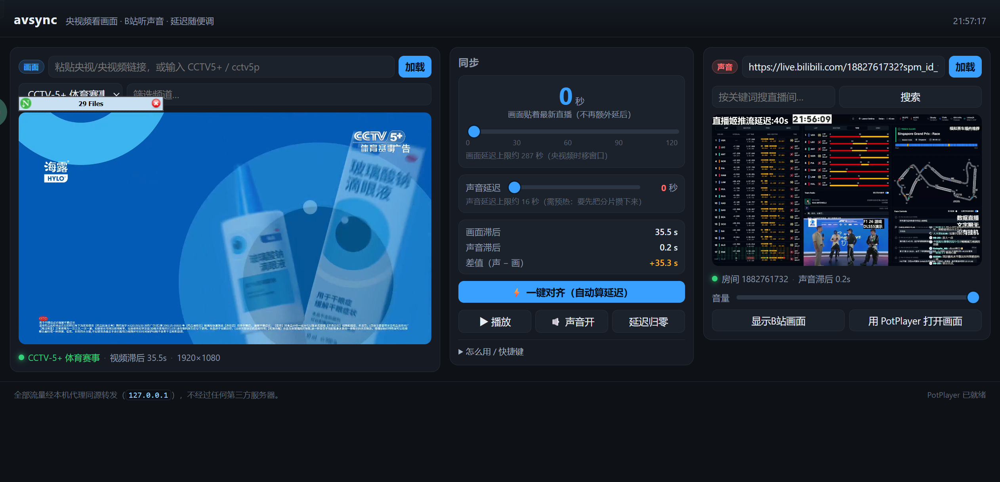

# avsync — 央视频看画面 · B站听声音 · 延迟随便调

百分百AIGC无人工代码添加

用途：**画面用央视频/央视的直播，声音用 B站直播**，两个源天然有几十秒的时差。
这个工具把两边都接到本机，然后让你把两边的时间差调平。



---

## 为什么需要本机一个服务

| 问题 | 说明 |
| --- | --- |
| 跨域 | 浏览器不允许一个网页同时拉央视频和 B站的流（CORS / 防盗链 Referer） |
| 取流协议 | 央视频要签名（JCE 时移、bkliveinfo + cKey 签名），B站要按房间取 playurl |
| 延迟 | 想"推迟 N 秒"，必须把分片先攒下来再按 N 秒下发 |

所以本工具做三件事：**取流 → 同源代理 → 按延迟切窗口下发**。
所有流量都只经过 `127.0.0.1`，不经过任何第三方服务器。

---

## 快速开始

1. 需要 **Node.js 18+**（自带 fetch）。
2. 双击 **`启动.cmd`**。
   - 它会自己在后台把服务起好，再打开浏览器 <http://127.0.0.1:8799/>
   - 那个黑窗口**可以关掉，关掉不会停服务**
   - 想停服务就双击 **`停止.cmd`**
3. 在「画面」框里粘贴**央视直播页链接**，或在下面选频道，点 **加载**。
   - 例：`https://tv.cctv.com/live/cctv5plus/`
   - 也认：`CCTV5+`、`cctv5p`、`CCTV-5+ 体育赛事`、央视频链接（带 `pid=`）
4. 在「声音」框里粘贴**B站直播间链接**，点 **加载**。
   - 例：`https://live.bilibili.com/1882761732`
   - 也认纯房间号。
   - `config.json` 里填了自己的 `biliCookie` 才有更高清晰度；不填也能听（最高约 1080p）。
5. 看中间「差值（声 − 画）」，按 **一键对齐**，或者手动拖两个延迟滑块。

### 如果双击没反应 / 窗口一闪而过

用下面这条能看到真正的报错（它会停在错误上，不闪退）：

```bat
cd /d <avsync 目录>
powershell -NoProfile -ExecutionPolicy Bypass -File start.ps1
```

服务端日志也会写到 `run.log` / `run.err`。

### 命令行方式（可选）

```bat
set PORT=8799
node server.mjs
```

想脚本化启动（不弹确认）：设 `AVSYNC_NO_PAUSE=1` 再调 `start.ps1`。
（启动/停止脚本一共 4 个文件：`启动.cmd`/`停止.cmd` 是入口，`start.ps1`/`stop.ps1` 是实现。）

---

## 怎么调延迟（原理，很简单）

界面里有两个数：

- **画面延迟** = 央视频画面比"最新直播"再往后推多少秒
- **声音延迟** = B站声音比"最新直播"再往后推多少秒

读数：

- **画面滞后 / 声音滞后** = 这条流距离它自己的实时边缘有多远
  （央视频用清单里的真实墙钟 `PROGRAM-DATE-TIME` 算，B站用播放窗口末端估算）
- **差值（声 − 画）** = 画面滞后 − 声音滞后
  - `+` 表示**画面更慢** → 把画面延迟调小（画面往前赶）
  - `−` 表示**画面更快** → 把画面延迟调大（画面往后退）
  - **调成 0 就是对齐了**

不想算就点 **一键对齐**：它先量稳定后的差值，再自动把两边延迟配到刚好抵消。
之后可以打开 **自动实时对齐**（快捷键 `R`），让它持续盯着差值自动纠偏——见下面一节。

> 延迟是**服务端**做的：改的是"下发给播放器的分片窗口"。
> 所以调好之后**不会像变速那样慢慢漂移**，换台/刷新也还在。

---

## 自动实时对齐是怎么工作的

两个直播流的延迟**会变**（CDN 调度、缓冲波动），所以对一次不够。自动对齐分两级：

| 偏差 | 手段 | 会不会打断播放 |
| --- | --- | --- |
| < 0.7 秒 | 恢复正常速率 | — |
| 0.7 ~ 3.5 秒 | 只改画面 **playbackRate**（约 ±0.3%~±2.5%） | 不打断，平滑纠偏 |
| > 3.5 秒 | 重算服务端**画面延迟**，单次最多调整 20 秒（间隔 ≥30 秒） | 需要重载 |

可拖动滑块用于手动设置，声音手动延迟上限仍是 15 秒。下面的绿色只读滑块单独记录一键对齐/自动粗调得到的画面服务端延迟，
范围为 0~300 秒；手动拖动不会改动这条自动结果显示。小于 3.5 秒的误差使用画面播放速率微调，
此时服务端延迟不变，自动状态会显示“播放速率微调”。手动改滑块或重新一键对齐后，旧的自动采样会清空，
等播放器重新稳定后再继续判断。

画面和声音各有一条只读的自动结果滑块，显示范围不受手动滑块限制。自动粗调时两条滑块平滑移动到新值；
小偏差用播放速率追赶时，画面自动结果条也会沿追赶方向实时动画。声音实际下发仍受 B 站分片有效期约 15 秒限制，
显示范围放宽不代表可以安全播放超过这个值的历史分片。

速率为什么能纠偏：速率差 1% 就是每秒挪 0.01 秒，2 秒的偏差约 200 秒补完——慢，
但完全无感（画面本来就静音，±1% 也不会有人看出来）。大偏差才值得重载一次。

### 它会不会被"内容不一样"干扰？

**不会看画面/听声音去判断**，它量的是纯时间：
两条流各自"距自己的实时边缘有多远"，差值就是两者在时间轴上的偏移。
所以下面这些都不影响它：

- 两边**机位不同**、构图不同（我实测时央视和 B站 就是两个不同机位，差值照样收敛到 −0.4 秒）
- 一边是**解说、一边是原声**，甚至两边**语言不同**
- 把 B站 音频当**副音轨/补充声源**用

它真正会被什么骗到：

1. **两条流不是同一场事件**（比如一个在放 A 场、一个在放 B 场）——那"对齐"就是对齐到
   各自的时间轴偏移，数字看着合理但内容当然对不上。**这种情况必须以耳朵为准。**
2. **两边本身就是不同步的画面**（一个机位比另一个慢很多）——那对齐到的是"延迟差"，
   未必等于你想要的"看着舒服"。用 `←/→`、`↑/↓` 手动补一个主观偏移即可。
3. **某一侧正在缓冲或卡住**时，那一侧的量值会短暂不准。自动对齐会先等两路连续稳定播放约 12 秒，
   再用较长的中位数窗口，并丢弃突跳采样，避免刚加载或重载时误调。

一句话：它保证的是 **"两个播放位置在时间轴上对齐"**，不保证 **"内容语义上对齐"**。
后者只能你来判断。当你只想把副音轨对上台标时，先点一次一键对齐，再用 ±1 秒微调最省事。

---

## 全屏

- 画面右上角的 **⛶ 全屏** 按钮
- **双击画面**任意位置
- 快捷键 **`F`**

---

## 两个源能延迟多少

| 源 | 上限 | 说明 |
| --- | --- | --- |
| 央视频（画面） | **约 120~300 秒** | 用的是央视时移接口，回看窗口 300 秒 |
| B站（声音） | **约 15 秒（安全上限）** | B站分片地址滚动过期：实测最新片约 36 秒失效，还要给播放器留出 8 片播放窗口 |

**主控制是「画面延迟」。** 注意分清两个不同的数：

- B站 页面上标的"延时 40s"= **B站 自己的流**相对现实慢了 40 秒 → 这段**改不了**
- 本工具的「声音延迟」= 让它**再往后拖**（离直播更远）→ 上限约 15 秒，滑块已按实际能力封顶，
  再调大只会下发死链，所以没有意义

刚加载 B 站时，服务端还没有历史分片。它会每秒轮询上游清单，把新分片放入本机缓冲；
只有仍在有效期内、并且扣除播放器所需播放窗口后的部分，才算“可安全延迟”。因此界面上的声音上限
会从 0 秒逐步升高，并显示“正在预热”。这不是浏览器在下载整段视频，而是为延迟窗口积累短分片。
上限不建议再抬高：分片签名会在几十秒内滚动失效，抬高后得到的是偶尔能播、随后必然 404 的死链。

所以正确做法是**反过来**：B站 慢多少，就把画面也往后延多少（画面能延 0~280 秒）。


---

## 快捷键

| 键 | 作用 |
| --- | --- |
| `空格` | 播放 / 暂停 |
| `F` | 全屏 / 退出全屏 |
| `←` `→` | 画面延迟 ∓1 秒（按住 `Shift` 是 ∓5 秒） |
| `↑` `↓` | 声音延迟 ±1 秒（`Shift` 是 ±5 秒） |
| `A` | 一键对齐 |
| `R` | 自动实时对齐 开 / 关 |
| `0` | 两个延迟都归零 |

## 其它

- **用 PotPlayer 打开画面**：把本代理的清单地址（含当前延迟）丢给 PotPlayer，
  想用大屏/硬解看画面时方便。路径在 `config.json` 里可配。
- **搜索**：按关键词搜 B站直播间，点结果直接加载。
- **显示 B站画面**：B站那边也有画面，默认显示，可以折叠。

---

## 排错

| 现象 | 原因 / 处理 |
| --- | --- |
| 画面框提示"暂无数据…请稍后重试" | 首次取流要 1~3 秒，bkliveinfo 那几路可能要 10 秒左右；播放器会自动重试 |
| 声音框报"该直播间当前未开播" | 直播间没在播（或已下播）；换一个房间号 |
| 声音延迟滑块拉不动 / 上限只有十几秒 | 这是 B站 的硬限制（分片地址滚动过期），不是 bug |
| 差值和实际听感不一致 | 以**耳朵**为准微调（`←/→`、`↑/↓`）；读数受播放器缓冲影响，有 1~3 秒误差 |
| 画面滞后一直是几十秒下不来 | 央视频本身就是延时直播（约 10~20 秒起），这是正常的 |

启动时加 `VERBOSE=1` 可以看到服务端日志。

## 已修掉的坑（备忘）

- **放一会儿画面卡住、要"延迟归零"才恢复**：根因是下发的 `#EXT-X-MEDIA-SEQUENCE` 恒为 0
  （央视频时移分片本身没有序号，被 `?? 0` 写死了）。播放器靠这个序号判断"清单有没有前进"，
  序号不动就可能不再取新分片。现在给每个入缓冲的分片分配单调递增序号。
- **频道下拉选了没反应**：`change` 回调是空的（历史遗留），只能点"加载"。
  现在选了就直接切台。

---

## 目录结构

```
avsync/
├─ 启动.cmd                 双击启动（纯 ASCII 引导，避免 cmd 按代码页读中文出错）
├─ start.ps1                真正干活的启动脚本（UTF-8 带 BOM，中文提示都在这里）
├─ 停止.cmd                 双击停止
├─ stop.ps1                 停服务的实现
├─ server.mjs               本机服务：路由 + 同源代理 + 延迟窗口
├─ ysp.mjs                  央视频取流（JCE 时移 / bkliveinfo+cKey 签名）+ 分片缓冲
├─ bili.mjs                 B站取流（房间号→playurl）+ 房间轮询缓冲
├─ http.mjs                 原生 http/https 请求（部分央视 CDN 会对 fetch 指纹返回 403）
├─ AGENTS.md                给接手改代码的 AI 看的说明（架构 / 约束 / 踩坑）
├─ config.example.json      可选配置样例（Cookie / 播放器路径）
├─ run.log / run.err        运行时日志（启动脚本写出，可随时删）
└─ public/                  网页前端（hls.js 已内置，离线可用）
```

## 踩坑记录（改文件时别再踩）

- **`.cmd` 要纯 ASCII 内容 + CRLF 行尾，文件名也尽量用 ASCII。**
  cmd.exe 按系统代码页解析批处理和文件名；按 UTF-8 存且只有 LF，会让脚本在第 8 行
  就报一堆"不是内部或外部命令"然后闪退。
- **`.ps1` 里的中文必须配 UTF-8 BOM。** Windows PowerShell 5.1 只有在有 BOM 时才按
  UTF-8 读脚本，否则按代码页读——中文标点的字节会被当成引号，把字符串截断、直接语法错误。
- **PowerShell 的 `\u` 转义只在双引号字符串里生效**，写在单引号里会原样输出成 `\u2014`。
- **改文本文件要用编辑工具，不要用 PowerShell 的 `Set-Content`。**
  它对本地编码的转换会把多字节字符写坏（本项目就被这样写坏过一次 77 个字符）。

## 声明

- 只做**取流与本地转发**，不存储、不转播、不二次分发任何内容。
- 分片直连官方 CDN，本机不跑视频流量（只有 B站的历史分片会短暂缓存在内存里）。
- 仅供个人观看便利使用，请遵守各平台的服务条款。

## 说明与致谢

- 央视频的取流协议（JCE 时移 + bkliveinfo/cKey 签名）参考并移植自开源项目
  [funwukong/ysp-live](https://github.com/funwukong/ysp-live)（纯 Python 实现），
  本工具用 Node.js 重写，并在此之上加了"分片缓冲 + 按延迟切窗口下发"。
- 央视频匿名接口最高 1080p；4K/HEVC 需要带设备签名的协议，本工具不含。
